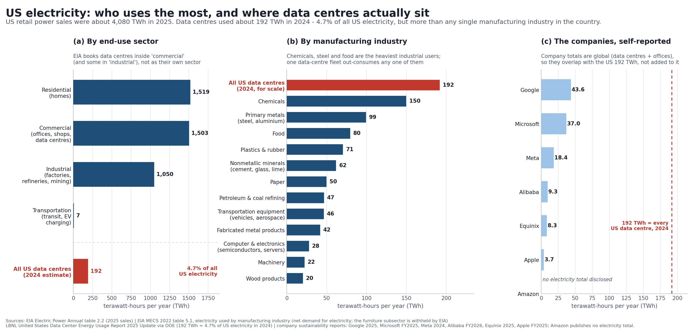

# Who uses the most electricity and water — and where data centres sit

**Live: <https://albertancoder.github.io/us-energy-water-data-centres/>**

An interactive one-pager plus two static charts, built from primary sources (EIA, USGS, LBNL,
company sustainability reports).

**`energy_water.html`** — the interactive version. Single self-contained file (no CDN, no build step,
works offline): open it in any browser.

- Three charts in one page: **electricity** (by sector / by industry / by company), **water** (by category /
  inside data centres / by company) and **what drives the bill** (PJM capacity prices).
- Controls per chart: tab switch, **log scale** (essential to see 0.05 against 133), **% of total**,
  hover tooltips with the exact figure, its share and the source note, and **download the current view as CSV**.
- Deep links into a specific view, e.g.
  `energy_water.html#elec=industries&water=datacentres&log=1`
  (`views: elec = sectors|industries|companies`, `water = categories|datacentres|companies`,
  `bills = price|cost`; plus `log=1`, `pct=1`).

Other files:

- `output/fig1_electricity.png` — static electricity chart (sector, industry, company)
- `output/fig2_water.png` — static water chart (categories, data-centre footprint, company)
- `output/chart_data.csv` — every plotted value with unit, year and source
- `output/preview.png` — a full-page screenshot of the HTML
- `make_charts.py` — regenerates the static PNGs and the CSV (`python make_charts.py`)
- `validate.py` — structural/syntax check of the HTML (`python validate.py`)

## Headline numbers

**Electricity**
| Who | Amount | Share / note |
|---|---|---|
| Homes (residential) | 1,519 TWh (2025) | 37% of retail sales |
| Commercial buildings | 1,503 TWh (2025) | data centres are booked inside this bucket |
| Industry | 1,050 TWh (2025) | factories, refineries, mining |
| **All US data centres** | **192 TWh (2024)** | **4.7% of all US electricity** |
| Chemicals — biggest manufacturing user | 150 TWh (2022) | 1.4x smaller than the data-centre fleet |
| Primary metals | 99 TWh (2022) | |
| Food | 80 TWh (2022) | |

Data-centre trajectory (LBNL): 76 TWh in 2018 → 176 in 2023 → 192 in 2024 → 464 in 2028 (reference case)
→ 649 TWh in 2030 (range 521–843, i.e. 9.5–15.3% of US electricity).

**Water** (USGS, 2015 — still the latest national census of water use)
| Use | Billion gallons/day | Share |
|---|---|---|
| Thermoelectric power plants | 133 | 41% |
| Irrigation | 118 | 37% |
| Public supply | 39 | 12% |
| Self-supplied industry | 14.8 | 4.6% |
| Aquaculture | 7.6 | 2.3% |
| Mining | 4.0 | 1.2% |
| Private wells | 3.5 | 1.1% |
| Livestock | 2.0 | 0.6% |
| **All US data centres (direct)** | **0.05** | **0.015%** |
| All US data centres incl. power-plant water | 0.63 | 0.2% |

The data-centre water nuance that matters: of its ~866 billion litres a year, only 66 billion (17.4 bn gallons,
0.375 L per kWh) is used on site; ~800 billion litres (4.52 L per kWh) is consumed upstream by the power stations
that supply it. Google is the largest single reported user (41 bn litres consumed in 2025); Microsoft 8 bn,
Equinix 4.6 bn, Meta 3.1 bn. Amazon and Apple each publish only one of the two metrics.

## So are data centres driving up bills?

Partly — and mostly indirectly:

- They are small in the total (4.7%) but they are almost all of the *growth*. LBNL's reference case has them
  supplying about a third of all US electricity demand growth from 2024 to 2030.
- Bills move through capacity and network costs, not through the servers' kWh directly. PJM's capacity auction
  went from $28.92/MW-day (2024/25) to $269.92 (2025/26) to $329.17 (2026/27, a price cap); total cost rose from
  $2.2bn to $16.1bn. PJM said the latest increase alone could mean 1.5–5% higher bills for some customers, and
  its forecast peak load grew ~5,500 MW "mainly from data centers". (Utility Dive, 23 Jul 2025.)
- Water is the weaker claim: nationally, direct data-centre water use is ~0.015% of withdrawals. Local effects are
  real — a single large campus can draw up to ~5 million gallons a day, which matters in a stressed aquifer — but
  it does not show up at national scale.

## Sources

- EIA, *Electric Power Annual*, table 2.2 (retail sales by sector through 2025): https://www.eia.gov/electricity/annual/html/epa_02_02.html
- EIA, *Manufacturing Energy Consumption Survey 2022*, table 5.1 (XLSX, downloaded to `data/mecs_5_1.xlsx`): https://www.eia.gov/consumption/manufacturing/data/2022/
- LBNL, *United States Data Center Energy Usage Report: 2025 Update* (2026) and *2024* edition; DOE release: https://www.energy.gov/articles/doe-releases-new-report-evaluating-increase-electricity-demand-data-centers
- LBNL water figures (66 bn L direct / 800 bn L indirect, 2023): https://eta-publications.lbl.gov/sites/default/files/2024-12/lbnl-2024-united-states-data-center-energy-usage-report_1.pdf
- USGS, *Estimated Use of Water in the United States in 2015*, Circular 1441: https://pubs.usgs.gov/publication/cir1441
- Company disclosures, compiled with page references: https://thefrontierwire.com/data/ai-water-and-energy-use/companies.csv
- PJM capacity auction results: https://www.utilitydive.com/news/pjm-interconnection-capacity-auction-prices/753798/
- Data-centre campus water draw (up to 5 Mgal/d): https://www.eesi.org/articles/view/data-centers-and-water-consumption

## Caveats

- Units are not interchangeable: electricity is TWh/year, water withdrawals are Bgal/day, company water is
  billion litres (= million m³)/year. Withdrawal ≠ consumption — a power plant can withdraw 133 Bgal/d and consume
  a small fraction of it.
- MECS covers manufacturing only (net demand for electricity, so on-site generation is excluded) and is a 2022
  survey; the data-centre estimate is 2024. Furniture is withheld by EIA for confidentiality.
- Company totals are company-wide and global (data centres plus offices), on different fiscal years and
  boundaries, so panel (c) is not a league table — it shows each company against its own reported numbers.
- USGS water data are for 2015, the most recent national compilation of this kind.
